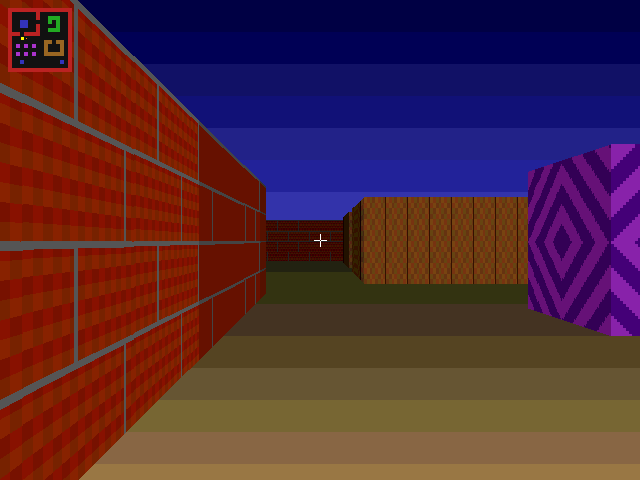
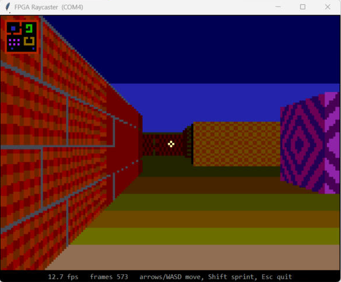
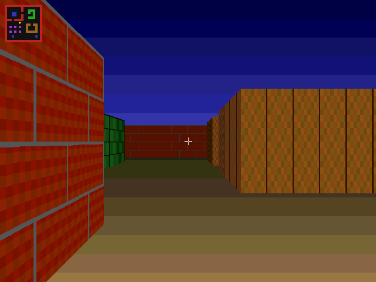

# FPGA Raycaster

[](https://github.com/AahyanS/fpga-raycaster/actions/workflows/sim.yml)

-orange)


A real-time, Wolfenstein-3D-style first-person renderer built **entirely in digital logic** on a Xilinx Artix-7. There is no CPU, no soft processor and no software running on the chip. A custom state machine casts 640 rays every frame, and a pixel pipeline textures, shades and fogs every pixel on its way out to a 640×480 @ 60 Hz VGA display.

No monitor? The board also streams the game to a laptop over the same USB cable used for programming, and the laptop keyboard can play it.



<sub>Walkthrough rendered by simulating the RTL cycle-accurately and capturing frames off the VGA pins.</sub>

<table>
<tr>
<td><br><sub>Running on a Basys 3, streamed live to the laptop viewer (160×120, ~12 fps)</sub></td>
<td><br><sub>Full-resolution 640×480 VGA output (simulated)</sub></td>
</tr>
</table>

## Highlights

- **Ray casting in hardware.** A DDA grid walk per screen column, with fisheye-corrected distance and texture coordinates.
- **Uses ~6% of its time budget.** About 100k of the 1.68M clock cycles in each 60 Hz frame. The LED bar on the board shows the engine load live.
- **Tear-free double buffering.** The engine renders the next frame while the current one is on screen.
- **Five procedural textures with zero texture memory.** Brick, stone, tiles, wood and diamonds are computed from (u, v) as pure logic.
- **Single 100 MHz clock domain, timing met.** Every multiply is sized to fit one DSP slice, and the pixel rate is a clock enable.
- **Plays with no monitor.** A USB-serial video stream to a Python viewer, with keyboard control coming back the other way.
- **Self-checking simulation in CI.** Frames are decoded from the VGA sync pins and checked against the USB stream pixel for pixel.

## Results on hardware (Basys 3, xc7a35t, Vivado 2026.1)

| Metric | Value |
|---|---|
| Clock | 100 MHz, **timing met** (worst setup slack +0.52 ns) |
| Video out | 640×480 @ 60 Hz VGA, 12-bit color |
| USB stream | 160×120 @ ~12 fps, 8-bit color, 3 Mbaud |
| Ray-casting time | ~6% of each frame |
| LUTs | 4,833 / 20,800 (23%) |
| Flip-flops | 1,212 / 41,600 (3%) |
| Block RAM tiles | 8 / 50 (16%) |
| DSP48E1 | 10 / 90 (11%) |

## Quick start

**What you need:** a Basys 3, its micro-USB cable, Vivado (2020.1 or newer; developed on 2026.1), and Python 3 with `pyserial` and `pillow` for the laptop viewer. A VGA monitor is optional.

### Play on the laptop (no monitor)

On Windows, double-click **`Play Raycaster.bat`**. It builds the bitstream if needed, loads it onto the board and opens the viewer. Or step by step:

```bash
pip install -r viewer/requirements.txt
vivado -mode batch -source scripts/build.tcl      # build (a few minutes)
vivado -mode batch -source scripts/program.tcl    # load onto the board
python viewer/viewer.py                           # auto-detects the COM port
```

### Play on a VGA monitor

Build and program as above, then plug a monitor into the board's VGA port. The VGA output and the USB stream run at the same time.

### Nexys A7

```bash
vivado -mode batch -source scripts/build.tcl -tclargs nexys
vivado -mode batch -source scripts/program.tcl -tclargs nexys
```

The Nexys A7-100T wrapper and constraints are included but have not been tested on hardware.

## Controls

| Board | Laptop | Action |
|---|---|---|
| BTNU / BTND | ↑ / ↓ or W / S | walk forward / back |
| BTNL / BTNR | ← / → or A / D | turn left / right |
| SW3 | Shift | sprint |
| BTNC | | respawn |
| SW0 | | hide minimap |
| SW1 | | disable distance fog |
| SW2 | | flat colors instead of textures |
| | Esc | close the viewer |

| Readout | Meaning |
|---|---|
| LED bar | engine load: one LED per 16k cycles spent ray-casting each frame |
| 7-segment | `X Y AA`: map cell X, map cell Y, view angle (hex, 256 steps per turn) |

## How it works

```
 buttons / laptop keys
        │
        ▼
     player ──camera (once per frame)──► ray_engine ──65-bit column records──► column buffer
  move, collide                          DDA grid walk,                         2 banks × 1024
                                         serial divider                         block RAM
                                                                                     │ front bank
 VGA timing ──(x, y)──► pixel pipeline: wall test → texture row → procedural texel ◄─┘
 640×480@60             → side + fog shading → minimap & crosshair ──┬──► VGA pins
                                                                     └──► frame_streamer ──► USB-UART ──► laptop
```

### Rendering a column

A raycaster only needs **one ray per screen column**, not one per pixel. For each of the 640 columns, `ray_engine.v` does the following:

1. `cameraX = 2x/640 − 1` (a constant multiply)
2. `ray = dir + plane · cameraX`
3. `deltaDist = |1/ray|` per axis (serial divider)
4. Walk the map grid, always stepping across whichever grid line is nearer, until it lands in a wall cell (DDA)
5. `perpDist = sideDist − deltaDist`. Measuring the distance perpendicular to the camera plane removes the fisheye effect, and needs no square root.
6. `lineHeight = 480 / perpDist` (serial divider)
7. Find the wall hit coordinate for texturing. The texture step is `perpDist · 64/480`, a multiply instead of a third divide.

Each column's result (wall top and bottom, texture column, texture step, wall type, side and fog level) is written to the column buffer. The display side turns each record back into 480 pixels as the beam scans.

### Design decisions

- **Time-multiplexed division.** Each ray needs three divisions. One 48/32-bit restoring divider (one bit per clock) handles all of them in ~150 cycles per column. A combinational divider would be enormous and slow, and the time budget is 16× larger than needed anyway.
- **Double buffering.** The column buffer has two banks. The engine fills the back bank while the front bank is displayed, and the banks swap at the start of vertical blanking.
- **One clock domain.** The 25 MHz pixel rate is a clock *enable* on the 100 MHz board clock, so there is no clocking IP and there are no clock-domain crossings.
- **DSP-sized arithmetic.** Every multiply is sized to fit one DSP48E1 (25×18), so each finishes in a single cycle without extra pipelining.
- **Registered camera pipeline.** The camera only changes once per frame, so `player.v` computes direction, plane and collision through a chain of registers that settles long before the next frame.
- **Fixed point throughout.** Positions, directions and distances are Q16.16, and trig is a 256-entry Q1.14 table.
- **Map as logic.** The 16×16 level is a combinational ROM, so the ray engine, collision logic and minimap each get their own free read port.

### USB video stream

The serial link carries about 300 KB/s, while live 640×480 video would need 18 MB/s. So `frame_streamer.v` grabs every 4th pixel of every 4th line straight from the pixel pipeline into block RAM. That gives a 160×120 image in 8-bit RRRGGGBB color, 19,200 bytes per frame. It then sends the frame behind a `0xFF` marker, with white sent as `0xFE` so the marker can never appear inside a frame.

Grabbing a whole frame before sending it means the picture never tears. Key presses come back as one byte (`101SUDLR`) about 30 times a second, and they release automatically if the viewer stops sending.

## Repository layout

```
rtl/
  raycaster_core.v     VGA timing, column buffer, pixel pipeline, textures, overlays
  ray_engine.v         per-column ray caster (DDA)
  udiv.v               serial restoring divider
  player.v             movement, rotation, collision
  frame_streamer.v     160×120 USB video stream
  uart.v               8N1 UART transmitter and receiver
  trig_lut.v           cos/sin ROM (generated)
  world_map.v          the level
  seven_seg.v          hex display driver
  top_basys3.v         Basys 3 pin wrapper
  top_nexys_a7.v       Nexys A7 pin wrapper
constraints/           pin constraints for each board
scripts/               Vivado build/program scripts, trig ROM generator
sim/                   testbenches, frame-to-image tools, test runner
viewer/                laptop viewer (Python)
docs/                  images used in this README
```

## Simulation and tests

Simulation needs Icarus Verilog or Verilator 5+, and Python 3 with Pillow.

```bash
make test    # self-checking: divider vectors + USB stream matches VGA
make sim     # render one frame to sim/out/frame_0000.png
make demo    # render the walkthrough GIF (~5 min with Verilator)
```

- **Full-system testbench** (`sim/tb_raycaster.v`). It drives the inputs from a script and reconstructs frames from the HSYNC and VSYNC pins the way a monitor would. It also models the laptop: it decodes the serial stream like `viewer.py` does and sends key presses back over serial.
- **Two simulators agree.** Icarus Verilog and Verilator produce bit-identical frames.
- **Divider test** (`sim/tb_udiv.v`). 2,000 randomized vectors including divide-by-zero, checked against a reference.
- **Stream check** (`sim/check_stream.py`). The streamed frame must match a downsampled VGA frame with zero mismatches.
- **CI** runs lint, the ROM regeneration check, the tests and a frame render on every push.

## Customizing

- **Change the level.** Edit the hex rows in `rtl/world_map.v`: `0` is floor and `1`–`5` are wall textures. Keep the outer ring solid.
- **Change the field of view.** `FOV_K` in `rtl/player.v` (0.66 gives ~66°).
- **Change move or turn speed.** The shifts and the angle step in `rtl/player.v`.
- **Change the textures.** The `texel` function in `rtl/raycaster_core.v`.

## Roadmap

- [ ] Textured floor and ceiling casting
- [ ] Sprites, using the column records as a depth buffer
- [ ] Sliding doors
- [ ] Load levels from the laptop over UART
- [ ] 1280×720 output using an MMCM

## License

[MIT](LICENSE) © 2026 Aahyan Salman
